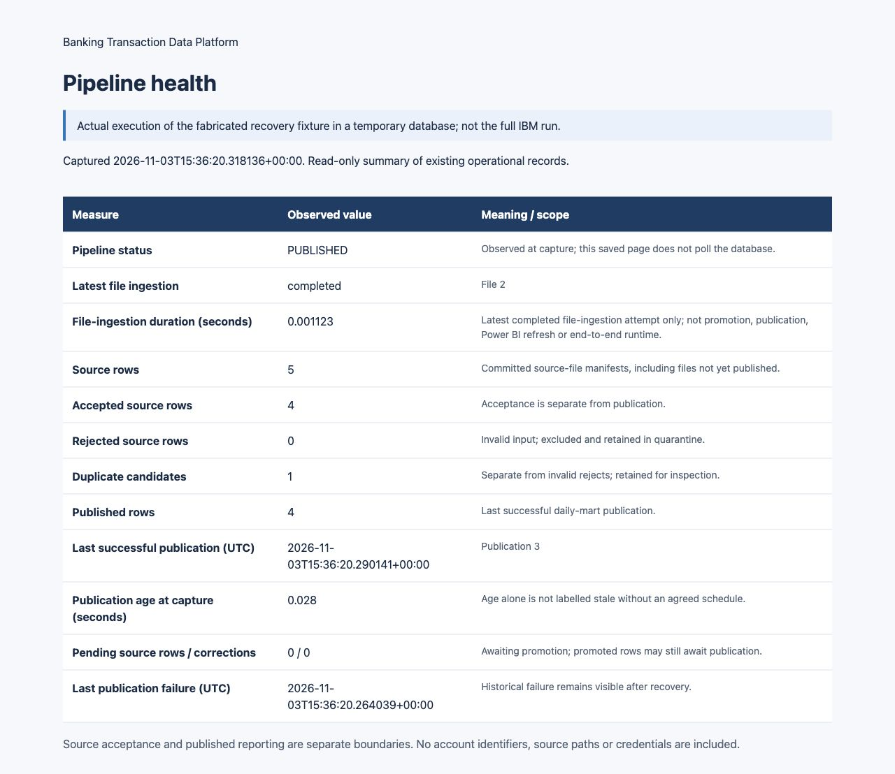

# One-table pipeline health summary

The pipeline already stores file status, ingestion start/completion timestamps,
row counts, publication timestamps, promotion cursors and failure logs. The new
exporter reads those records without adding another metrics store or modifying
the source database.

From the repository root with dependencies installed:

```sh
python -m banking_pipeline.health --dsn postgresql:///YOUR_LOCAL_DATABASE
```

Alternatively use `BANKING_DATABASE_URL`. Outputs are
`data/processed/pipeline-health.json` and `pipeline-health.html`; change their
paths with `--output` and `--html`. Open the HTML file in a browser. It is one
saved summary table, not a polling dashboard. All timestamps are UTC.

## Definitions

| Field | Source and interpretation |
| --- | --- |
| Pipeline status | Current source/correction file states, unpromoted records, pending publication and failures newer than the corresponding success |
| Latest file ingestion status | Most recently started source-file attempt in `ops.file_manifest` |
| File-ingestion duration | Recorded `completed_at - started_at` for that completed attempt; null for incomplete/failed attempts |
| Source / accepted / rejected / duplicate counts | Committed source manifests; may include rows not yet published |
| Published rows | Last successfully committed `analytics.fact_daily_transaction` |
| Last successful publication | `analytics.publication_state.published_at`, with its publication ID |
| Publication age | Seconds between that timestamp and this export; no stale/fresh threshold is invented |
| Pending source / correction rows | IDs beyond the promotion cursors |
| Last publication failure | Historical `ops.analytics_failure` timestamp; remains visible after recovery |

Status precedence is failed files, loading, unresolved publication failure,
unresolved promotion failure, awaiting promotion, awaiting publication, then
published/no publication/no data. A later successful publication clears the
active publication-failed state while retaining the historical failure time.

The ingestion interval excludes initial file hashing, promotion, publication,
database commit overhead and Power BI refresh. Promotion/publication currently
do not provide reliable end-to-end start/end timing, so that duration is not
claimed. The view does not establish completeness of external source delivery.

## Actual demonstration evidence

The recovery demonstration writes a JSON snapshot and HTML summary after each
step. The checked-in [blocked-publication table](evidence/recovery_demo/4_blocked_publication_health.html)
and [recovered table](evidence/recovery_demo/5_recovered_health.html) come from
the fabricated five-source-row fixture, not the historic 5.08-million-row run.
They show that accepted source counts can advance while the published count and
last successful publication remain unchanged during a failure. Run
`python scripts/demo_banking_recovery.py` to regenerate them locally.


